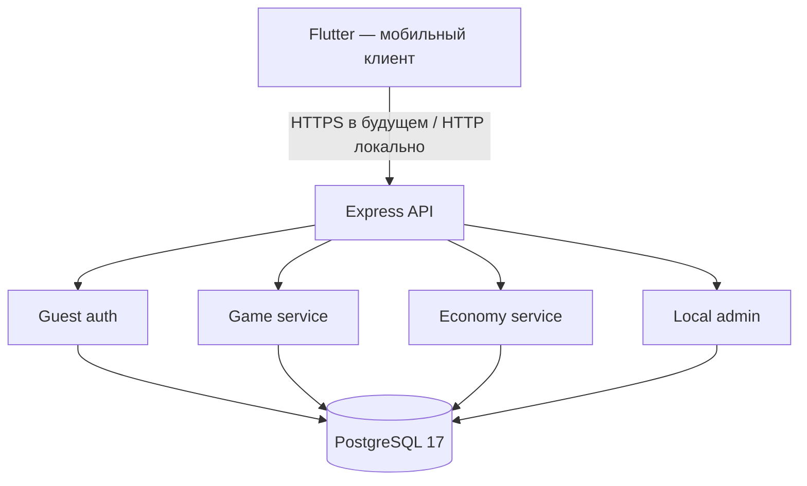

# Архитектура

Backend реализован как **модульный монолит**: один Node.js-процесс, один HTTP API и PostgreSQL. Основные игровые правила сосредоточены в сервисах, а маршруты отвечают за ввод, авторизацию и HTTP-ответы.

> Сейчас сервер слушает **только loopback** (`127.0.0.1`). Публичный HTTPS, масштабирование и защита рекламных/платёжных событий — отдельные задачи перед релизом.

## Слои

| Слой | Основные файлы | Ответственность |
|:--|:--|:--|
| HTTP | `index.js`, `routes/auth.js`, `routes/game.js`, `routes/admin.js` | Маршрутизация, форматы запросов, ответы и статус-коды |
| Авторизация | `services/guestAuthService.js`, `lib/guestTokens.js` | Гость, хешированные токены, ротация и отзыв |
| Криптограммы | `services/gameService.js`, `lib/puzzleText.js` | Попытки, шифрование, проверка букв, подсказки, бонус |
| Экономика | `services/economyService.js`, `lib/economyRules.js` | Награды, покупки, жизнь и монеты в транзакциях |
| Данные | `db.js`, `db/migrations/`, `scripts/db-migrate.js` | PostgreSQL и версионированные изменения схемы |
| Контент | `content/`, `scripts/content-import-drafts.js` | Импорт непроверенных цитат только в черновики |

Некоторые старые файлы в `routes/` остались в репозитории как наследие прежней версии. **Они не равнозначны активному публичному API**: в `index.js` старые маршруты отключены, а актуальные пути используют `/api/v1/auth` и `/api/v1/game`.

## Ключевые инварианты

### Один номер — несколько отдельных клеток

При создании попытки каждая различная кириллическая буква получает уникальное число. Числовое соответствие сохраняется в `puzzle_attempts.cipher_map` и не меняется при повторном открытии уровня.

Клетка идентифицируется `(attempt_id, cell_position)`, а не номером шифра. Если в цитате два раза встретилась буква «В» и обе клетки получили число 4, ввод «В» в первую клетку **не заполняет** вторую.

### Проверка происходит при вводе буквы

- Сервер проверяет **только выбранную позицию**.
- Верная буква закрепляется и не может быть заменена.
- Неверная не сохраняется: увеличивается `mistakes`, а после каждой третьей ошибки снимается одна жизнь.
- При нуле жизней ввод и платные подсказки блокируются до восстановления или покупки.
- После последней верной буквы уровень закрывается автоматически; устаревший `/check` возвращает `410`.

Черновой блокнот (`puzzle_notes`) хранит гипотезы и не валидирует их, не подставляет в клетки.

### Данные и награды принадлежат серверу

Мобильный клиент не выбирает баланс, стоимость товаров, правильные буквы и размер награды. API проверяет владельца попытки через гостевой токен. Источник и автор цитаты скрыты до завершения, а раскрытие происходит после бонусного этапа.

### Идемпотентность

`PATCH /cells/:position` требует `requestId`: результат записывается в `puzzle_letter_requests`. Повтор того же запроса возвращает сохранённый ответ и не расходует дополнительные попытки. Повтор ID с изменёнными параметрами — конфликт.

Покупки используют UUID запроса; награды и списания пишутся в `economy_ledger` с уникальным ключом события. Блокировки строк (`FOR UPDATE`) и SQL-транзакции защищают от одновременных изменений одного аккаунта/попытки.

## Почему не микросервисы

Механика игры тесно связывает ввод букв, жизни, монеты и прогресс. Один backend позволяет провести эти изменения **одной транзакцией PostgreSQL**, не вводя очереди и распределённые транзакции раньше времени. По мере развития можно выделять модули без пересмотра игрового контракта.

## Границы текущей реализации

- **Реализовано:** игровой API, гостевые сессии, магазин за монеты, черновой каталог, бонус, транзакционная экономика.
- **Структура подготовлена, игровой сценарий впереди:** полноценное сюжетное «Дело 404».
- **Не реализовано:** реальные рекламные награды, платежи, восстановление гостевого аккаунта после потери токена, публичная инфраструктура и проверенная медиабиблиотека.

См. [API](GAME_API.md), [базу данных](DATABASE.md) и [ограничения безопасности](SECURITY.md).
